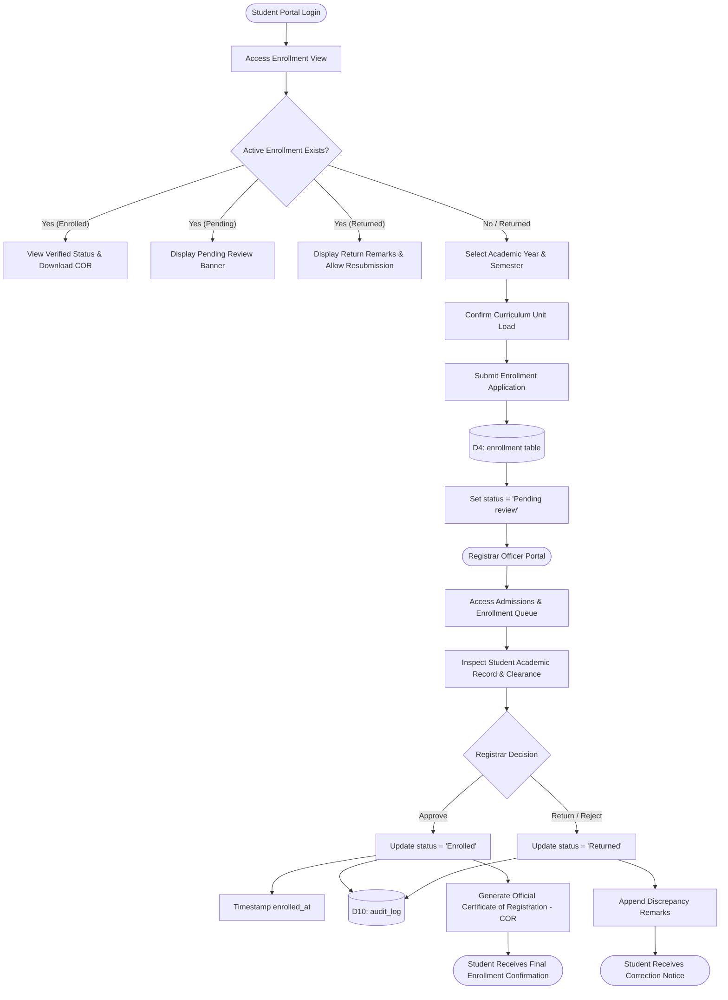

# CuyoTech University System: Reverse-Engineered SSIS Architecture & Technical Analysis

**Document Version:** 1.0.0  
**Project Location:** `C:\xampp\htdocs\CuyoTech-University`  
**Generated Date:** October 2026  
**Deliverable Directory:** `docs/ssis-diagrams/`  
**Target Architecture:** System Structure and Information System (SSIS) Models

---

## 1. Executive Summary & Reverse-Engineering Methodology

The **CuyoTech University** web application is an integrated institutional management information system developed to automate core academic and administrative university operations. In conventional software engineering, System Structure and Information System (SSIS) specifications are formulated during analysis and design phases preceding implementation. For this engagement, a rigorous **reverse-engineering** process was conducted on the pre-existing production codebase and database schemas located at `C:\xampp\htdocs\CuyoTech-University`.

The system implementation serves as the definitive **source of truth**. No hypothetical features, external frameworks, or artificial workflows were injected. The resulting models capture the operational realities, relational structures, data flows, and behavioral constraints embodied in the application source code.

### Summary of SSIS Deliverables

| Deliverable ID | Diagram Title | File Name | Source File | Description |
|---|---|---|---|---|
| **01** | **Enrollment Process Workflow** | `01-use-case-or-activity-diagram.png` | `01-use-case-or-activity-diagram.puml` | Primary choice: Swimlane Activity Diagram modeling the complete enrollment lifecycle with decision points. |
| **01 (Supp.)** | **Enrollment Use Case Diagram** | `01-use-case-diagram-enrollment.png` | `01-use-case-diagram-enrollment.puml` | Supplementary UML Use Case model specifying actors, system boundary, `<<include>>`, and `<<extend>>` relations. |
| **02** | **Level 0 Context Diagram** | `02-level-0-context-diagram.png` | `02-level-0-context-diagram.dot` | **Gane & Sarson notation**: DFD Context Diagram defining the unified system process `0.0`, all 6 external entities, and boundary data flows. |
| **03** | **Level 1 Data Flow Diagram** | `03-level-1-dfd.png` | `03-level-1-dfd.dot` | **Gane & Sarson notation**: Functional decomposition into Processes `1.0`–`7.0`, Data Stores `D1`–`D12` with standard Gane & Sarson store blocks, and external entities. |
| **04** | **UML Class Diagram** | `04-class-diagram.png` | `04-class-diagram.puml` | Logical domain model detailing the 6 required entities (`Student`, `Department`, `DocumentRequest`, `Payment`, `Course`, `AdminUser`) plus system entities, attributes, methods, and multiplicities. |
| **Doc** | **System Analysis Report** | `SYSTEM_ANALYSIS.md` | Markdown | Comprehensive architectural analysis, workflow traces, entity dictionary, and implementation gap analysis. |

---

## 2. Technology Stack & Architectural Characteristics

Thorough inspection of the directory structure and codebase reveals the following technological foundation:

```
C:\xampp\htdocs\CuyoTech-University\
├── admin/                 # System Administrator Portal & User Management
├── assets/                # Static CSS, JavaScript, vendor libraries, and logos
├── cashier/               # Cashiering, Fee Collections & Official Receipts
├── database/              # MySQL Relational Schema (database.sql)
├── dept/                  # Academic Department Heads & Clearance Verification
├── docs/                  # System documentation & SSIS Diagram exports
├── includes/              # Shared library routines (bootstrap.php, config.php, auth helpers)
├── registrar/             # Registrar Office, Admissions, Document Processing & Grades
├── student/               # Student Self-Service Portal (documents, grades, clearance, profile)
├── index.php              # University Public Landing Page
├── login.php              # Multi-role Unified Authentication Gateway
├── contact.php            # Public Inquiry & University Support Desk
└── README.md              # Project Documentation
```

### Architectural Profile
1. **Application Architecture:** Multi-tier monolithic web application adhering to procedural PHP module boundaries structured by role-based directory routing.
2. **Server Runtime:** Apache HTTP Server on PHP 8.x (XAMPP Environment).
3. **Database Engine:** MySQL / MariaDB Relational Database Management System.
4. **Data Access Layer:** PHP Data Objects (`PDO`) executing prepared statements with parameter binding for SQL injection deterrence.
5. **Session & State Management:** Server-side native PHP sessions (`$_SESSION`) secured with session regeneration, credential hashing (`password_hash` / `password_verify`), and rate-limited brute-force tracking (`login_attempt` table).
6. **Presentation Layer:** Semantic HTML5 augmented with responsive CSS styling (Tailwind CSS utility classes & custom CSS modules) and vanilla JavaScript for dynamic DOM interaction and AJAX modal handling.

> [!NOTE]
> **Procedural to Object-Oriented Domain Mapping:**
> The existing application is implemented using **procedural PHP** rather than an Object-Relational Mapping (ORM) framework like Doctrine or Eloquent. Consequently, the classes represented in Deliverable 04 model the **logical domain entities** distilled directly from the relational tables, persistent records, and domain operations executed within PHP script controllers.

---

## 3. Core Workflows & Operational Processes

Detailed code tracing was conducted across all module directories to identify the end-to-end execution paths of the system.

### 3.1 Workflow 1: Student Enrollment Lifecycle (Priority Process)
The enrollment process was verified as the primary operational workflow connecting the Student Portal (`student/index.php`) and the Registrar Administration Portal (`registrar/index.php`).



#### Detailed Process Execution Steps:
1. **Application Initiation:** The student navigates to the enrollment screen. The system queries `enrollment` where `student_id = :id` ordered by `id DESC`.
2. **Eligibility Evaluation:** If the student's latest enrollment is marked `Enrolled`, enrollment inputs are locked, displaying the registered subjects and Certificate of Registration (COR). If `Pending review`, submission is disabled to prevent duplicate applications. If `Returned` or absent, the enrollment form is unlocked.
3. **Payload Submission:** The student submits target `academic_year`, `semester`, and `year_level`. An `INSERT` query records the entry into `enrollment` with `status = 'Pending review'`.
4. **Registrar Review:** A registrar officer logs into `registrar/index.php`, querying all records where `status = 'Pending review'`.
5. **Decision Branching:**
   - **Branch A (Approval):** The officer clicks *Confirm Enrollment*. The status transitions to `Enrolled`, `enrolled_at` is set to `NOW()`, and an entry is logged in `audit_log`. The student can immediately view their enrolled course roster and print their COR.
   - **Branch B (Return):** The officer specifies deficiency remarks (e.g., unpaid fees or unsubmitted documents) and clicks *Return Application*. The status transitions to `Returned`. The student is alerted and granted permission to rectify the application.

---

### 3.2 Workflow 2: Academic Document Requests & Issuance
Implemented in `student/documents.php` and `registrar/index.php`:
1. **Document Selection:** The student chooses from predefined document categories:
   - Transcript of Records (TOR)
   - Certificate of Grades (COG)
   - Certificate of Enrollment (COE)
   - Good Moral Certificate
   - Honorable Dismissal
2. **Fee Computation:** The application calculates total fees based on document type and copy count (`amount = unit_price * copies`).
3. **Status Pipeline:** The request progresses through discrete database states in `document_request`:
   - `Pending` $\rightarrow$ Initial student filing. Student may cancel while in this state.
   - `Processing` $\rightarrow$ Acknowledged and queued by Registrar staff.
   - `Ready for Pickup` $\rightarrow$ Document printed, sealed, and staged at the registrar window.
   - `Released` $\rightarrow$ Claimed by student; recorded with `released_at = NOW()`.
   - `Cancelled` $\rightarrow$ Revoked by student or rejected by registrar.

---

### 3.3 Workflow 3: University Clearance Processing
Implemented across `dept/index.php`, `admin/index.php`, and `student/index.php`:
1. **Clearance Record Genesis:** A clearance record is created in `clearance` for each student per semester.
2. **Multi-Office Sign-Off:** The record maintains dedicated status columns for five university offices:
   - `library_status` (Library clearance / unreturned books)
   - `laboratory_status` (Equipment / laboratory breakages)
   - `dean_status` (Departmental academic clearance)
   - `cashier_status` (Settlement of outstanding balances)
   - `registrar_status` (Final documentary completion)
3. **Automated Overall Evaluation:** When department heads or administrators sign off on individual departments, the system executes an evaluation check:
   $$\text{overall\_status} = \begin{cases} \text{'Cleared'}, & \text{if all 5 offices} = \text{'Cleared'} \\ \text{'Pending'}, & \text{otherwise} \end{cases}$$
4. **Administrative Override:** System administrators retain bypass privileges to update clearance states during exceptional academic circumstances.

---

### 3.4 Workflow 4: Fee Assessment & Cashier Collections
Implemented in `cashier/index.php`:
1. **Student Billing Lookup:** The cashier queries student profiles and outstanding balances via student ID.
2. **Transaction Recording:** The cashier enters payment details into `payment`:
   - `or_number` (Unique Official Receipt number)
   - `amount` (Paid monetary amount)
   - `payment_type` (`Tuition`, `Document Fee`, `Clearance Fee`, or `Other`)
   - `payment_method` (`Cash`, `Bank Transfer`, `GCash`)
   - `reference_number` (For bank/electronic remittances)
   - `processed_by` (Foreign key to cashier's `user_account.id`)
3. **Receipt Generation:** Generates a printable official receipt and recalculates student account balances.

---

### 3.5 Workflow 5: Academic Records & Grade Evaluation
Implemented in `registrar/index.php`:
1. **Curriculum & Schedule Scheduling:** Subjects are defined with code, title, units, schedule, room, and department linkage in `subject`.
2. **Grade Encoding:** Faculty and registrar officers enter `midterm` and `final` ratings into `grade`.
3. **Publishing Control:** Grades remain in draft status until `is_published = 1` is toggled, preventing premature disclosure prior to official academic council review.
4. **Scholastic Standing Evaluation:** Computes Weighted Grade Averages (WGA) and flags passing or failing marks for graduation clearance.

---

### 3.6 Workflow 6: Identity, Role-Based Access Control & System Audit
Implemented in `login.php`, `includes/bootstrap.php`, and `admin/index.php`:
1. **Authentication:** Single login portal verifying credentials against `user_account` via `password_verify()`.
2. **Role Routing:** Dispatches authenticated sessions based on role:
   - `student` $\rightarrow$ `student/index.php`
   - `registrar` $\rightarrow$ `registrar/index.php`
   - `cashier` $\rightarrow$ `cashier/index.php`
   - `dept_head` $\rightarrow$ `dept/index.php`
   - `admin` $\rightarrow$ `admin/index.php`
3. **Rate Limiting:** Consecutive failed attempts within 15 minutes are logged in `login_attempt`. Accounts exceeding threshold limits are locked.
4. **Audit Logging:** Administrative overrides, user modifications, and grade publications trigger structured inserts into `audit_log` with IP address and user-agent metadata.

---

## 4. SSIS Model Deliverable Specifications

### 4.1 Deliverable 01: Process Modeling (Activity Diagram vs. Use Case Diagram)

#### Selection Rationale:
In compliance with project requirements, the **Enrollment Process** was selected because it represents the most feature-complete, interactive, and multi-participant workflow in the CuyoTech codebase.

Between an Activity Diagram and a Use Case Diagram, the **Activity Diagram (`01-use-case-or-activity-diagram.png`)** was chosen as the **primary model** for the following architectural reasons:
1. **Dynamic Sequential Execution:** Enrollment is governed by strict chronological preconditions, decision branching, and state transitions (`Pending review` $\rightarrow$ `Enrolled` / `Returned`) that cannot be adequately visualized through static use case bubbles alone.
2. **Swimlane Separation:** Using three explicit swimlanes (**Student**, **CuyoTech SSIS Application**, and **Registrar Officer**), the activity diagram articulates the precise distribution of client input, automated database validation, and administrative authorization.
3. **Decision Guards:** Clearly illustrates the review branch `[Approved]` versus `[Discrepancy / Incomplete]` and the corrective loopback mechanism.

> [!TIP]
> **Supplementary Deliverable Provided:**  
> To provide complete modeling coverage, a supplementary **Use Case Diagram (`01-use-case-diagram-enrollment.png`)** was also engineered and rendered. It illustrates the Student and Registrar actors interacting with the *Enroll in Academic Term* usecase, complete with `<<include>>` dependencies (*Verify Account Session*, *Select Academic Term & Subjects*, *Validate Prerequisites*) and `<<extend>>` variations (*Return with Incomplete Notice*, *Download Official COR*).

---

### 4.2 Deliverable 02: DFD Level 0 — Context Diagram (Gane & Sarson Notation)

The Context Diagram defines the operational boundary of the CuyoTech University System adhering to **Gane & Sarson (SSADM)** notation:
- **Central Process (`0.0`):** Modeled as a **rounded rectangular process box** with a distinct top header containing the process number (`0`) on the left and the system boundary designation (`CuyoTech University System`) in the primary body.
- **External Entities (6):** Modeled as **sharp rectangular terminator blocks** (filled in standard yellow) representing autonomous actors and external systems interfacing with the CuyoTech application:
  1. `Student`: Submits enrollment, files document requests, views grades, clearance, and payment history.
  2. `Registrar Officer`: Evaluates admissions, approves enrollments, encodes grades, and releases certificates.
  3. `Cashier Officer`: Records fee payments, issues official receipts, and monitors balances.
  4. `Department Head`: Reviews departmental rosters, passes academic ratings, and signs off on clearance.
  5. `System Administrator`: Manages user accounts, configures departments, inspects audit logs, and executes overrides.
  6. `Public Inquirer`: Submits prospective student questions and campus inquiries via `contact.php`.

```
========================================================================================
                          LEVEL 0 CONTEXT DIAGRAM BOUNDARY MAP
========================================================================================
  [Student]               [Registrar Officer]              [Cashier Officer]
      │                           │                                │
      ├─(Enrollment / Docs)───────┤                                │
      │                           ├─(Approve Enrollment / Grades)──┤
      │                           │                                ├─(Payments / Receipts)
      ▼                           ▼                                ▼
┌──────────────────────────────────────────────────────────────────────────────────────┐
│                                                                                      │
│                         0.0 CUYOTECH UNIVERSITY SYSTEM                              │
│                                                                                      │
└──────────────────────────────────────────────────────────────────────────────────────┘
      ▲                           ▲                                ▲
      │                           │                                │
      ├─(Clearance Sign-offs)─────┤                                │
      │                           ├─(Accounts / Overrides / Logs)──┤
      │                           │                                ├─(Inquiry / Notice)
  [Department Head]       [System Administrator]            [Public Inquirer]
========================================================================================
```

---

### 4.3 Deliverable 03: DFD Level 1 — Functional Decomposition (Gane & Sarson Notation)

The Level 1 Data Flow Diagram decomposes the system into **seven (7) discrete operational processes** interacting with **twelve (12) persistent data stores** corresponding directly to the relational database tables, rendered strictly using **Gane & Sarson notation**:
- **Processes (`1.0` to `7.0`):** Rounded rectangles featuring a top header section displaying the process numerical ID on the left and a white main body containing the process title.
- **External Entities:** Sharp yellow rectangular blocks representing external sources and sinks (`Student`, `Registrar Officer`, `Cashier Officer`, `Department Head`, `System Administrator`, `Public Inquirer`).
- **Data Stores (`D1` to `D12`):** Classic Gane & Sarson data store blocks featuring a gray prefix compartment containing the identifier (`D#`) and a yellow body containing the database table name.
- **Data Flows:** Directed solid arrows with clear annotations tracing data input/output exchanges.

#### Functional Processes:
- **`1.0 User Authentication & Account Administration`**: Coordinates login sessions, credential verification against `D1: user_account`, rate-limit tracking via `D11: login_attempt`, and administrative maintenance by the System Administrator.
- **`2.0 Enrollment Application & Review`**: Manages the end-to-end student enrollment submission, verifies departmental constraints (`D2`, `D3`), reads and writes application records to `D4: enrollment`, logs actions to `D10: audit_log`, and outputs status updates to both Student and Registrar.
- **`3.0 Academic Records & Grade Evaluation`**: Handles subject curriculum data (`D5: subject`), grade encoding by academic staff, weighted average computation, and grade storage in `D6: grade`.
- **`4.0 Document Request & Processing`**: Processes requests for transcripts, certificates, and clearances; tracks status changes across `D7: document_request`; and coordinates fee assessments.
- **`5.0 Fee Assessment & Payment Processing`**: Calculates tuition and document fees, processes payment remittances via the Cashier Officer, and logs official receipts in `D8: payment`.
- **`6.0 University Clearance Verification`**: Coordinates the 5-office clearance cycle across `D9: clearance`, department listings (`D3`), and student profiles (`D2`), providing consolidated clearance certifications upon full sign-off.
- **`7.0 Student Support & Inquiry Handling`**: Ingests public inquiries submitted via `contact.php` into `D12: inquiry` and returns automated acknowledgement notices.

#### Data Stores Dictionary:
| Store ID | Table Name | Description | Key Attributes |
|---|---|---|---|
| `D1` | `user_account` | User credentials, roles, statuses | `id`, `username`, `password`, `role`, `status` |
| `D2` | `student` | Master student demographic profiles | `id`, `student_id`, `department_id`, `email`, `year_level` |
| `D3` | `department` | College departments and deans | `id`, `code`, `name`, `dean` |
| `D4` | `enrollment` | Term enrollment requests and statuses | `id`, `student_id`, `academic_year`, `status`, `remarks` |
| `D5` | `subject` | Academic subjects, units, schedules | `id`, `code`, `title`, `units`, `schedule`, `room` |
| `D6` | `grade` | Midterm, final, and published grades | `id`, `student_id`, `subject_id`, `midterm`, `final`, `remarks` |
| `D7` | `document_request` | Official school document orders | `id`, `student_id`, `document_type`, `amount`, `status` |
| `D8` | `payment` | Official receipts and financial records | `id`, `student_id`, `or_number`, `amount`, `payment_type` |
| `D9` | `clearance` | Multi-office student clearances | `id`, `student_id`, `library_status`, `overall_status` |
| `D10` | `audit_log` | System-wide immutable security logs | `id`, `user_id`, `action`, `details`, `ip_address` |
| `D11` | `login_attempt` | Security brute-force tracking | `id`, `ip_address`, `username`, `attempted_at` |
| `D12` | `inquiry` | External support tickets and inquiries | `id`, `full_name`, `email`, `subject`, `message` |

#### Level 0 to Level 1 Balancing Verification:
Every incoming and outgoing data flow entering or exiting the `0.0` boundary in the Context Diagram maps to an external entity connection in the Level 1 DFD:
- **Student:** Inputs (Enrollment Submission, Document Request, Credentials) $\rightarrow$ Process 2.0, 4.0, 1.0; Outputs (Confirmed COR, Request Status, Auth Session) $\leftarrow$ Process 2.0, 4.0, 1.0.
- **Registrar:** Inputs (Review Decisions, Grade Encodings, Status Updates) $\rightarrow$ Process 2.0, 3.0, 4.0; Outputs (Enrollment Queue, Grade Sheets, Pending Requests) $\leftarrow$ Process 2.0, 3.0, 4.0.
- **Cashier:** Inputs (Payment Postings) $\rightarrow$ Process 5.0; Outputs (Assessments, Receipts) $\leftarrow$ Process 5.0.
- **Dept Head:** Inputs (Clearance Approvals) $\rightarrow$ Process 6.0; Outputs (Rosters, Stats) $\leftarrow$ Process 6.0.
- **Admin:** Inputs (Overrides, Account CRUD) $\rightarrow$ Process 1.0, 6.0; Outputs (Account Matrix, Audit Trail) $\leftarrow$ Process 1.0.
- **Public Inquirer:** Inputs (Inquiry Form) $\rightarrow$ Process 7.0; Outputs (Acknowledgment Notice) $\leftarrow$ Process 7.0.

---

### 4.4 Deliverable 04: UML Class Diagram (Domain Entity Model)

The UML Class Diagram models the physical MySQL database schema and procedural domain controllers into an enterprise object model.

#### Required Entity Mapping Matrix:
| Logical Entity | Physical Table | Cardinality & Multiplicity | Relationships | Primary Methods & Responsibilities |
|---|---|---|---|---|
| **`Student`** | `student` | $1 \text{ to } 0..*$ | Aggregation from `Department`, Composition with `Enrollment`, `Grade`, `Clearance`, `Payment`, `DocumentRequest` | `applyEnrollment()`, `requestDocument()`, `viewGrades()`, `viewClearanceStatus()`, `viewPaymentHistory()` |
| **`Department`** | `department` | $1 \text{ to } 0..*$ | Aggregates `Student`, Composes `Course` | `getStudentCount()`, `getSubjects()`, `getFacultyList()`, `calculatePassingRate()` |
| **`DocumentRequest`** | `document_request` | $0..* \text{ to } 1$ | Composed by `Student` (`ON DELETE CASCADE`) | `calculateTotalFee()`, `updateProcessingStatus()`, `markAsReleased()`, `cancelRequest()` |
| **`Payment`** | `payment` | $0..* \text{ to } 1$ | Composed by `Student`, Associated with `UserAccount` (`processed_by`) | `generateOfficialReceipt()`, `recordTransaction()`, `verifyPaymentReference()`, `printReceipt()` |
| **`Course`** | `subject` | $1 \text{ to } 0..*$ | Composed by `Department`, Associated with `Grade` | `assignSchedule()`, `getEnrolledStudents()`, `calculateAverageGrade()`, `getUnitLoad()` |
| **`AdminUser`** | `user_account` (`role='admin'`) | $1 \text{ to } 1$ | Specialization / Inheritance (`--\|>`) of `UserAccount` | `createUserAccount()`, `toggleAccountStatus()`, `resetUserPassword()`, `inspectAuditTrail()`, `overrideClearance()` |

#### Multiplicity & Association Summary:
- **`Department` (1) $\diamond$-- (0..\*) `Student`**: A department oversees zero or more registered students; each student is enrolled in exactly one academic department.
- **`Department` (1) \*-- (0..\*) `Course`**: A department offers and governs multiple courses (`subject` records); each course belongs to one department.
- **`UserAccount` (1) -- (0..1) `Student`**: A one-to-one logical association linking authenticated student credentials with a demographic student record via `student_id`.
- **`UserAccount` $\triangle$-- `AdminUser`**: Generalization/Inheritance hierarchy where `AdminUser` inherits authentication capabilities while implementing administrative override and security operations.
- **`Student` (1) \*-- (0..\*) `Enrollment`**: A student possesses zero or more semester enrollment records. (Composition: deleting a student cascades to remove their enrollment records).
- **`Student` (1) \*-- (0..\*) `Grade`**: A student receives academic grades for enrolled subjects.
- **`Course` (1) <-- (0..\*) `Grade`**: Each grade entry links to exactly one course (`subject_id`).
- **`Student` (1) \*-- (0..\*) `Clearance`**: Tracks term-based multi-office clearance statuses.
- **`Student` (1) \*-- (0..\*) `Payment`**: Student settles tuition and fee transactions.
- **`UserAccount` (1) --> (0..\*) `Payment`**: Cashier user account tracks the processing officer (`processed_by`).
- **`Student` (1) \*-- (0..\*) `DocumentRequest`**: Student orders transcripts and certifications.
- **`UserAccount` (1) --> (0..\*) `AuditLog`**: Security audit entries record originating user accounts.

---

## 5. Architectural Findings, Gaps & Recommendations

Reverse-engineering the codebase revealed several architectural strengths alongside opportunities for improvement:

### 5.1 Architectural Strengths
1. **Defensive SQL Queries:** Widespread adoption of `PDO` prepared statements with parameterized inputs throughout the codebase protects against SQL injection vulnerabilities.
2. **Robust Password Hashing:** User passwords are stored using PHP's native `PASSWORD_BCRYPT` through `password_hash()`, preventing plaintext exposure.
3. **Structured Audit Trail:** Sensitive administrative events, account modifications, and grade publications generate traceable records in `audit_log` with IP addresses and browser fingerprints.
4. **Referential Integrity:** The relational schema in `database/database.sql` utilizes foreign key constraints (`ON DELETE CASCADE` and `ON UPDATE CASCADE`) to maintain database integrity across dependent tables.

### 5.2 Identified Implementation Gaps & Incomplete Workflows
1. **Absence of Real-time Payment Gateway Integration:**
   - *Observation:* While the `payment` schema supports `GCash` and `Bank Transfer`, payment recording is strictly manual via cashier staff in `cashier/index.php`.
   - *Recommendation:* Integrate an asynchronous webhook listener to process automated payment notifications from financial gateways.
2. **Prerequisite Validation Engine:**
   - *Observation:* In `student/index.php`, course enrollment allows term subject selection, but automated prerequisite checking against historical passing grades in `grade` is not enforced in the procedural code.
   - *Recommendation:* Introduce an automated validation rule in the enrollment submission pipeline to verify prerequisite completion prior to setting status to `Pending review`.
3. **Document Tracking Notification Service:**
   - *Observation:* Status transitions for document requests (e.g., from `Processing` to `Ready for Pickup`) are visible on the student portal, but no automated email or SMS notifications are dispatched.
   - *Recommendation:* Implement a background email dispatch service to notify students when document requests change status.
4. **Environment Note on Inspection:**
   - *Observation:* During the reverse-engineering analysis, the local MySQL daemon was not running. All database models, constraints, and table definitions were reverse-engineered directly from `database/database.sql`, `sql/database.sql`, and inline SQL statements in PHP files.

---

## 6. Verification & File Manifest

All generated diagrams have been validated, inspected for label legibility, and stored in the project repository:

```
C:\xampp\htdocs\CuyoTech-University\docs\ssis-diagrams\
├── 01-use-case-or-activity-diagram.png     # Primary Deliverable 1: Enrollment Process Activity Diagram (76 KB)
├── 01-use-case-or-activity-diagram.puml    # Editable PlantUML source for Deliverable 1
├── 01-activity-diagram-enrollment.png      # High-res standalone copy of Activity Diagram (76 KB)
├── 01-activity-diagram-enrollment.puml     # PlantUML source
├── 01-use-case-diagram-enrollment.png      # Supplementary Deliverable: Enrollment Use Case Diagram (103 KB)
├── 01-use-case-diagram-enrollment.puml     # Editable PlantUML source for Use Case Diagram
├── 02-level-0-context-diagram.png          # Deliverable 2: High-res DFD Context Diagram (851 KB)
├── 02-level-0-context-diagram.dot          # Editable Graphviz DOT source for Level 0 DFD
├── 03-level-1-dfd.png                      # Deliverable 3: High-res Level 1 DFD (1.58 MB)
├── 03-level-1-dfd.dot                      # Editable Graphviz DOT source for Level 1 DFD
├── 04-class-diagram.png                    # Deliverable 4: UML Domain Class Diagram (279 KB)
├── 04-class-diagram.puml                   # Editable PlantUML source for UML Class Diagram
└── SYSTEM_ANALYSIS.md                      # Comprehensive SSIS Technical Documentation (This file)
```

**End of Analysis Report**
